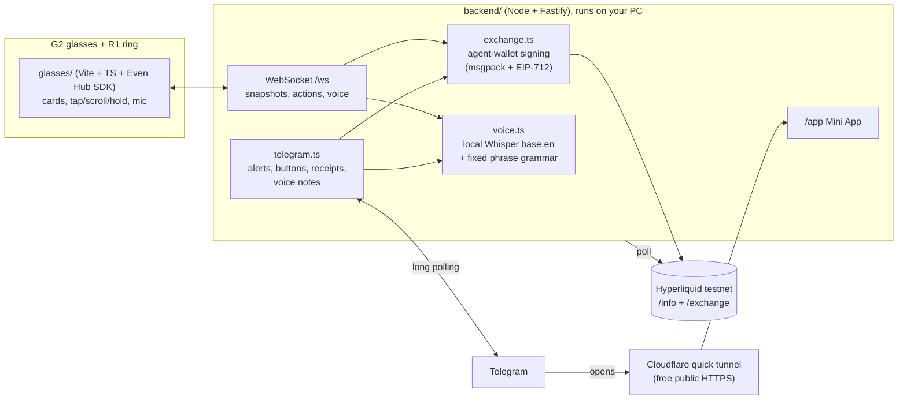

# PerpGuard

[](https://github.com/JahanzaibMohsin9/perpguard/actions/workflows/ci.yml)

**See how close your Hyperliquid position is to liquidation at a glance on Even Realities G2 glasses, then protect it in seconds with a tap, your voice, or Telegram.**

Built for *Heads Up: Even Realities Hackathon* (TVM Ventures & Daos Hub), Nov 23–29, 2026.
Tracks: **02 Crypto & DeFi (Hyperliquid)** + **01 Messaging (Telegram)**.

**▶ Try it in your browser (no install):** https://jahanzaibmohsin9.github.io/perpguard/
It's the real glasses card on live Hyperliquid data for any address, with a "random live trader" button.

> ⚠️ **Testnet only.** PerpGuard trades on the Hyperliquid **testnet** and never holds user funds. It gives no financial advice. Every action is **protective**: it can reduce or protect a position, but it never opens or increases one.

| Live risk card | Tap menu | Confirm | Receipt | Hold to talk |
|---|---|---|---|---|
|  |  |  |  |  |

## The problem

Leveraged traders get liquidated while they are away from their screens: walking, driving, or in a meeting. Checking an exchange app means taking out the phone, unlocking it, and navigating, which is too slow when price is moving. PerpGuard puts the one number that matters (**how far you are from liquidation**) in your line of sight. It lets you act on that number without taking out your phone.

## What it does

| Surface | Features |
|---|---|
| **G2 glasses** | Live card per position: PnL, mark and liquidation price, % distance to liquidation, **time to liquidation at the current pace**, a safety bar, and an OK / ▲ WARNING / ▲ DANGER label. Riskiest position first. **Tap**: actions menu → confirm → result. **Hold to talk**: say *"close half"*, *"close all"*, *"break even"* or *"two percent stop"*. |
| **Telegram bot** | Alerts when a position moves OK → WARNING → DANGER (and back to safe), with action buttons. `/status`, `/alerts 8 3`, `/guardian on`, `/pause`, `/resume`. **Receipts** for every action, showing the new liquidation distance and **how many seconds after the alert** the position was protected. **Voice notes** in private chats and in **group chats** (a shared trading desk): the bot transcribes them and replies with confirm buttons. |
| **Telegram Mini App** | Live dashboard inside Telegram with the same protective buttons, and **spectator mode** to watch any address read-only. |

### 🛡 Guardian mode (opt-in)
Guardian is a dead man's switch for the moments you **can't** answer: asleep, driving or in a meeting.
1. When a position enters DANGER, Guardian arms a countdown (60 s by default). It shows on the glasses as `★ GUARDIAN closes 25% in 42s`, and in Telegram with a **Cancel** button.
2. If **nobody acts** before the countdown runs out, PerpGuard protects the position itself:
   - it **closes 25%** (reduce-only), and
   - it places a **safety stop just before the liquidation price**, so the position exits before the exchange liquidates it (an existing tighter stop is kept).
3. Any action you take (tap, voice, Telegram or Mini App), or the risk easing, cancels the countdown.

It acts at most once per position every 10 minutes. Turn it on in Telegram with `/guardian on` (or `/guardian on 60 25`), and off with `/guardian off`.

The four protective actions are **Close 50%**, **Close all**, **Stop at break-even** (refused when it would trigger immediately) and **Stop 2% away**. All four are reduce-only orders. A new stop replaces the old one, so stops never pile up.

## Safety design

- **Agent (API) wallet.** PerpGuard signs with a Hyperliquid API wallet. That wallet can place and cancel orders for the account, but it **cannot withdraw**. When the backend starts, it checks on-chain that the agent is approved by the watched account. Trading stays disabled unless that check passes **and** the network is testnet.
- **Every action is confirmed.**
  - Glasses: the confirm screen cancels itself after 10 s.
  - Telegram buttons: the confirmation expires after 60 s.
  - Mini App: a confirm sheet.
  - Voice: voice only *selects* an action, and you still confirm it with a tap.
- **Fixed phrases, no LLM.** Speech is matched against a small grammar, so random speech can't become an order. Whisper runs **locally**, and the audio never leaves the machine.
- **Who may trade.**
  - The glasses may trade only through a connection from the same machine.
  - Remote clients (the Mini App, via the tunnel) start **read-only**. They can trade only after sending Telegram `initData` that passes **HMAC verification** and belongs to a linked chat or linked-group member.
  - Linking a Telegram chat requires a private pairing link.
  - **Glasses that are not on the server's machine** (the packaged app on a phone) start read-only and show a **6-digit pairing code**. A linked user sends `/pair 482913` to the bot from a private chat, and the glasses receive a device token kept in the glasses' storage. Only a SHA-256 hash of each token is stored on the server. `/devices` lists the paired glasses, and `/unpair` revokes them all.
- **One action at a time** across glasses, bot and Mini App.

## How it works



- `shared/protocol.ts` holds the message types used by the glasses, the backend and the Mini App.
- Liquidation distance = `(mark − liq) / mark` for longs and `(liq − mark) / mark` for shorts.
- **Order signing** follows Hyperliquid's L1 action scheme: msgpack of the action, the nonce, and a phantom-agent EIP-712 signature. It is implemented directly with `viem` and `@msgpack/msgpack`, with no exchange SDK.

## Run it locally

Requirements: **Node.js 22.12+**, plus the Even Hub tools:

```bash
npm i -g @evenrealities/evenhub-cli @evenrealities/evenhub-simulator
npm install
cp backend/.env.example backend/.env
```

### 1. Watch an account (read-only)
In `backend/.env`, set `HL_WATCH_ADDRESS` to a Hyperliquid **testnet** address. Then:
```bash
npm run dev:backend     # http://localhost:8787 (Whisper downloads ~80 MB on first run)
npm run dev:glasses     # http://localhost:5173
npm run sim             # Even Hub simulator
```

### 2. Enable protective actions (agent wallet)
1. On **app.hyperliquid-testnet.xyz/API**, create an API wallet and authorize it with your wallet.
2. Put its private key in `backend/.env` as `HL_AGENT_KEY`. `HL_WATCH_ADDRESS` must be the account that authorized it.
3. Restart the backend. The log should say `Trading enabled`.

The agent key can trade but can never withdraw. Even so, never commit `.env`.

### 3. Telegram (optional)
1. Create a bot with **@BotFather**. Run `/setjoingroups` → Enable and `/setprivacy` → Disable (needed for group voice notes).
2. Set `TELEGRAM_BOT_TOKEN` in `backend/.env`. Where Telegram is blocked, set `TELEGRAM_PROXY` to your VPN's local HTTP proxy, e.g. `http://127.0.0.1:17890`.
3. Start the backend. It logs a **private pairing link**. Open it to link your chat, or use `?startgroup=<code>` to link a group.
4. Mini App: set `TUNNEL=cloudflare`. The backend opens a free Cloudflare quick tunnel and points the bot's menu button at it. Send `/app` to get a button.

### Environment variables (`backend/.env`)
| Variable | Purpose |
|---|---|
| `HL_NETWORK` | `testnet` (trading is refused on anything else) |
| `HL_WATCH_ADDRESS` | Account to watch and protect |
| `HL_AGENT_KEY` | API wallet key; leave empty for read-only |
| `POLL_MS` | Snapshot interval for the glasses (default 3000) |
| `TELEGRAM_BOT_TOKEN`, `TELEGRAM_PROXY` | Telegram bot, and an optional HTTP proxy for it |
| `TUNNEL` | `cloudflare` to serve the Mini App on a public URL |
| `WHISPER_MODEL`, `VOICE` | Whisper model id (default `onnx-community/whisper-base.en`); `VOICE=off` disables voice |

### Dev scripts (`backend/scripts/`, testnet only)
- `voice-test.ts`: transcribe WAV files and show which command each maps to.
- `demo-position.ts`: set up an isolated-margin demo position, so the card shows real WARNING or DANGER. This is a dev tool; the product itself never opens positions.
- `fund-testnet.ts`, `bridge-gas.ts`: an experimental free testnet-funding route (Circle CCTP). It is **unreliable**: Hyperliquid's testnet forwarder drops most deposits. Use the official faucet instead.

## Tests

```bash
npm test    # 16 unit tests, also run by GitHub Actions on every push
```

They cover:
- **Order signing:** the action hash matches the **official Hyperliquid Python SDK golden vector**, and signatures recover to the agent address. Number formatting is checked too.
- **Risk:** liquidation distance for longs and shorts, alert levels, and hysteresis.
- **Voice grammar:** known phrases map to actions. Unknown speech, "buy" commands and Whisper's silence hallucinations map to nothing.
- **Telegram Mini App login:** valid launch data passes. Tampered, foreign-bot and stale data is rejected.
- **Glasses cards:** only glyphs the G2 display can render, and every card fits the lens.

## Notes and limitations

- **Unified accounts.** With Hyperliquid's unified account mode, cross-margin positions are backed by the whole balance, so the liquidation price can be far away. Isolated margin shows the real per-position risk.
- **Display.** The G2 text card uses only glyphs known to render on the display (no emoji).
- **Real glasses.** Built and tested in the Even Hub simulator. On real glasses, set the backend's public origin in `glasses/app.json` → `permissions[network].whitelist`, then package with `npm run pack -w glasses`.

## Feature requests (for the teams behind the APIs we used)

1. **Hyperliquid: scoped API wallets.** Add an agent permission for **reduce-only orders**. Today an API wallet can do any trade. A "protect-only" key would let safety tools like PerpGuard prove they can't open or increase positions, which is safer for users and easier to trust.
2. **Hyperliquid: dependable testnet funding for developers.**
   - The testnet faucet requires a mainnet deposit first.
   - The Circle CCTP → HyperCore testnet forwarder often never credits deposits: the funds reach the deposit wallet and stop there.
   - A developer faucet, or a reliable forwarder, would remove the biggest blocker for new builders.
3. **Even Hub: glasses notifications while the app is closed.** Let a backend (or a bound Telegram bot) push a short notice to the HUD. Then a liquidation alert can reach the wearer without the app in the foreground.
4. **Even Hub: built-in speech-to-text, and better simulator audio testing.**
   - A first-party transcription or short-intent API would spare every app from streaming raw PCM to its own server.
   - The simulator automation API should accept a WAV file as mic input, so voice flows can be tested automatically.
5. **Telegram Bot API: voice-message transcription for bots.** Telegram already transcribes voice notes for Premium users. Exposing that to bots would let voice-driven bots run without their own speech-to-text stack.

## What existed before the hackathon

Nothing. This repository was created on **Nov 23, 2026**, and everything in it was written during build week.

It uses these open-source libraries and models:
- Even Hub SDK
- Fastify
- Vite
- TypeScript
- viem
- @msgpack/msgpack
- transformers.js with Whisper base.en
- ffmpeg-static
- undici
- cloudflared

## License

MIT
